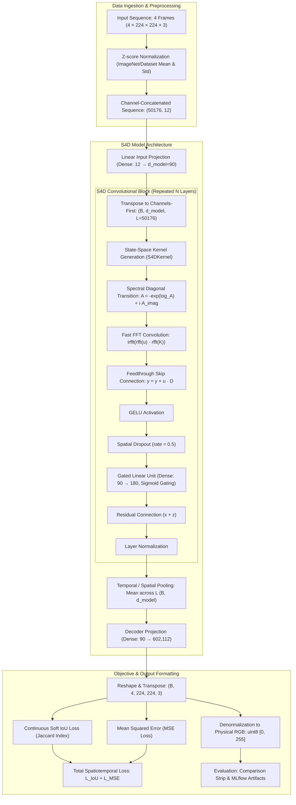
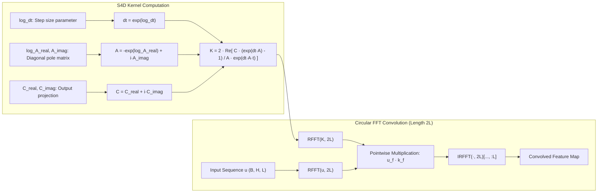

# S4D Spatiotemporal Sequence Prediction Model Report

## 1. Executive Summary

This report documents the architectural design, mathematical foundations, objective functions, training dynamics, and empirical evaluation of the **Diagonal Structured State Space (S4D) Sequence Model** implemented in `S4D-iou.py` (and `ssmi.py`).

The model is tailored for **multi-frame meteorological / convective cloud sequence forecasting** ($4 \to 4$ frame predictive learning). Given $4$ consecutive past observation frames ($t = 0, 1, 2, 3$), the network autoregressively predicts the subsequent $4$ future frames ($t = 4, 5, 6, 7$) at $224 \times 224$ resolution across RGB channels.

---

## 2. Architectural Scheme & Flow Diagram

### 2.1 End-to-End System Pipeline



---

### 2.2 S4D Kernel & Fast Convolution Scheme



---

## 3. Mathematical Formulation

### 3.1 Continuous State Space Representation
A Continuous-Time State Space Model (SSM) maps a 1D input sequence $u(t) \in \mathbb{R}$ to an output sequence $y(t) \in \mathbb{R}$ through an $N$-dimensional latent state $x(t) \in \mathbb{C}^N$:

$$\dot{x}(t) = \mathbf{A} x(t) + \mathbf{B} u(t)$$
$$y(t) = \mathbf{C} x(t) + \mathbf{D} u(t)$$

### 3.2 Diagonal S4D Parameterization
Unlike standard S4 which requires a low-rank decomposition of the HiPPO matrix ($A = \Lambda - P P^*$), **S4D** parameterizes $\mathbf{A}$ as a purely **diagonal complex matrix**:

$$\mathbf{A} = \operatorname{diag}\left(\lambda_1, \lambda_2, \dots, \lambda_{N/2}\right), \quad \lambda_n = -\exp(\alpha_n) + i \pi n$$

where $\alpha_n \in \mathbb{R}$ is initialized to enforce negative real parts ($\operatorname{Re}(\lambda_n) < 0$), ensuring bounded-input bounded-output (BIBO) stability.

### 3.3 Discretization and Convolutional Kernel
Under zero-order hold (ZOH) discretization with sample step $\Delta t = \exp(\log \Delta t)$:

$$\overline{\mathbf{A}} = \exp(\Delta t \mathbf{A})$$
$$\overline{\mathbf{B}} = (\Delta t \mathbf{A})^{-1} (\overline{\mathbf{A}} - \mathbf{I}) \cdot (\Delta t \mathbf{B}) = (\overline{\mathbf{A}} - \mathbf{I}) \mathbf{A}^{-1} \mathbf{B}$$

Because $\overline{\mathbf{A}}$ is diagonal, the impulse response kernel $\mathbf{K} \in \mathbb{R}^L$ simplifies analytically to:

$$\mathbf{K}_l = \mathbf{C} \overline{\mathbf{A}}^l \overline{\mathbf{B}} = 2 \cdot \operatorname{Re}\left[ \sum_{n=1}^{N/2} \mathbf{C}_n \frac{\exp(\Delta t \lambda_n) - 1}{\lambda_n} \exp(l \Delta t \lambda_n) \right]$$

The entire sequence of length $L = 50,176$ is convolved in parallel in $\mathcal{O}(L \log L)$ time using the Fast Fourier Transform (FFT):

$$y = \mathcal{F}^{-1}_{2L} \left( \mathcal{F}_{2L}(u) \odot \mathcal{F}_{2L}(\mathbf{K}) \right)_{[:L]} + \mathbf{D} \odot u$$

---

## 4. Tensor Dimensions & Parameter Specification

| Stage | Tensor Dimension | Elements / Units | Description |
| :--- | :--- | :--- | :--- |
| **Input Sequence** | $(B, 4, 224, 224, 3)$ | $602,112$ per batch item | 4 chronological past frames |
| **Flattened Features** | $(B, 50176, 12)$ | $50,176 \times 12$ | 224×224 pixels with 12 channels concatenated |
| **Encoder Output** | $(B, 50176, 90)$ | $d_{\text{model}} = 90$ | Linear projection from 12 to 90 |
| **S4D State** | $(90, 64)$ | $N = 64$ ($32$ complex pairs) | Diagonal state space per channel |
| **Gated Unit Output** | $(B, 50176, 90)$ | $180 \to 90$ Gated Linear Unit | $y_1 \odot \sigma(y_2)$ activation |
| **Mean Pooling** | $(B, 90)$ | 90 features | Collapsed spatial representations |
| **Decoder Output** | $(B, 602112)$ | $4 \times 224 \times 224 \times 3$ | Dense projection $(90 \to 602,112)$ |
| **Unflattened Target** | $(B, 4, 224, 224, 3)$ | 4 future frames | Reshaped back to $(4, 224, 224, 3)$ |

### Parameter Breakdown ($d_{\text{model}} = 90, N = 64$)
- **Input Projection (`Dense: 12 → 90`)**: $1,170$ parameters.
- **S4D Layer (`s4_0`)**: $28,440$ parameters.
  - S4D Kernel parameters ($\log \Delta t, \mathbf{C}, \mathbf{A}$): $11,610$.
  - Feedthrough parameter $\mathbf{D}$: $90$.
  - Output dense projection (`Dense: 90 → 180`): $16,380$.
  - LayerNorm: $180$.
- **Decoder Projection (`Dense: 90 → 602112`)**: $54,792,192$ parameters.
- **Total Model Parameters**: $\approx \mathbf{54.82 \times 10^6}$ ($54.82\text{ M}$).

---

## 5. Loss Function: Continuous Soft IoU + MSE

In meteorology and convective cloud forecasting, pure MSE/L1 tends to produce oversmoothed, blurry predictions due to the multimodality of cloud motion. The model optimizes a **Continuous Jaccard Index (IoU) Loss** coupled with patch-space MSE:

### 5.1 Continuous Soft IoU (Jaccard Index)
Let $\hat{y} \in \mathbb{R}^D$ and $y \in \mathbb{R}^D$ denote model predictions and normalized ground truth:

1. Constrain predictions via Sigmoid: $\tilde{y} = \sigma(\hat{y}) \in (0, 1)$.
2. Min-max scale ground truth targets: $y_{\text{norm}} = \operatorname{clip}\left(\frac{y - \min(y)}{\max(y) - \min(y) + \epsilon}, 0, 1\right)$.
3. Compute continuous Intersection and Union:
   $$\text{Intersection} = \sum_{d=1}^D \min(\tilde{y}_d, y_{\text{norm}, d})$$
   $$\text{Union} = \sum_{d=1}^D \max(\tilde{y}_d, y_{\text{norm}, d})$$
4. Soft IoU Loss:
   $$\mathcal{L}_{\text{IoU}} = 1.0 - \frac{\text{Intersection} + \epsilon}{\text{Union} + \epsilon}$$

### 5.2 Compound Spatiotemporal Loss
$$\mathcal{L}_{\text{total}} = \mathcal{L}_{\text{IoU}}(\tilde{y}, y_{\text{norm}}) + \frac{1}{D} \sum_{d=1}^D (\hat{y}_d - y_d)^2$$

This compound objective ensures strong $O(1)$ Euclidean gradients for low-frequency structural alignment while the continuous IoU sharpens high-frequency cloud boundaries.

---

## 6. Training & Resource Configuration

- **Optimizer**: Multi-transform Optax:
  - AdamW for standard dense layers with Cosine Decay ($\eta_0 = 10^{-3}$, weight decay $= 10^{-2}$).
  - Specialized Adam for S4D kernel parameters with conservative learning rate ($\eta \le 10^{-3}$).
- **Batch Size**: `batch_size = 4` (calibrated for 8 GB RTX 4070 VRAM).
- **DataLoader**: Grain with `num_workers = 0` (in-process loading):
  - Completely avoids multi-process CUDA context duplication.
  - Eliminates POSIX shared memory leaks in `/dev/shm` and prevents `SIGBUS (exit code -7)`.
- **Validation & Checkpointing**:
  - Orbax Checkpoint Manager saves top 3 checkpoints on validation loss improvements.
  - Periodic visual evaluation triggered every `args.eval_every` (5) epochs.

---

## 7. Visual Evaluation Strip Structure

Every 5 epochs, `visualize_predictions` runs inference on held-out validation samples, unrolls the flattened arrays, denormalizes pixel values with dataset channel statistics ($\mu, \sigma$), and outputs side-by-side comparison strips:

```text
+---------------------------------------------------------------------------------------------------+
| Row 1 (Ground Truth Sequence):                                                                    |
| [Input t=0] | [Input t=1] | [Input t=2] | [Input t=3] || [GT t=4]   | [GT t=5]   | [GT t=6]   | [GT t=7]   |
+---------------------------------------------------------------------------------------------------+
| Row 2 (Model Predicted Sequence):                                                                 |
| [Input t=0] | [Input t=1] | [Input t=2] | [Input t=3] || [Pred t=4] | [Pred t=5] | [Pred t=6] | [Pred t=7] |
+---------------------------------------------------------------------------------------------------+
```

All evaluation strips, individual ground-truth frames, and prediction frames are logged to `./ssmi_eval_images/epoch_XXX/` and synced directly into MLflow under the `ConvLSTM-vs-S4D` experiment.
